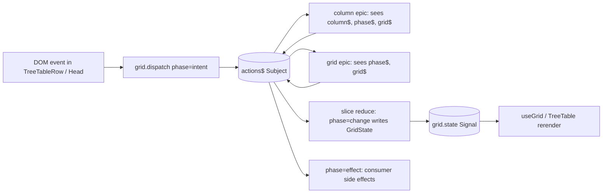

# Grid epics: column defs that own their dispatch receivers

## TOC
1. Pipeline
2. Type signatures (signals `createSlice` / `createEpic`, grid `GridAction`, `TreeColumn.epic`)
3. Pseudo-code bodies
4. Instance lifetimes
5. Storage layout, read/write sequence, uniqueness
6. Worked trace: alt-click on status cell opens a pivot
7. What this replaces in the two consumers
8. Open decisions

## 1. Pipeline



Caption: one bus, three phases. `intent` is raw and cancellable, `change` is the only writer to `GridState`, `effect` leaves the grid. Epics turn intents into changes or effects; reducers never see intents.

## 2. Type signatures

### signals `packages/signals/src/10_slice.ts` (new)

```ts
import type { Observable, Subscription } from "rxjs"
import type { Signal } from "./0_types.js"

export type Reducer<S, A> = (state: S, action: A) => S

export type Epic<A, S, Ctx = {}> = (
  actions$: Observable<A>,
  state: Signal<S>,
  ctx: Ctx,
) => Observable<A>

export type Slice<S, A> = {
  state: Signal<S>            // Signal(actions$.pipe(filter, scanEager(reduce, initial)), initial)
  actions$: Observable<A>     // dispatch$ merged with every epic output, feedback via loop Subject
  dispatch: (action: A) => void
}

export function createSlice<S, A, Ctx = {}>(config: {
  initial: S
  reduce: Reducer<S, A>
  epics?: readonly Epic<A, S, Ctx>[]
  ctx?: Ctx
}): Slice<S, A>
// Lifetime is rxjs: Signal(observable) already wraps its source in shareReplay({ refCount: true })
// (signals/src/1_SignalCreator.ts:80). First subscriber to state.$ connects the epics, last unsubscribe tears them down.

export function createEpic<A, S, Ctx = {}>(epic: Epic<A, S, Ctx>): Epic<A, S, Ctx>
// identity with a name slot; exists so call sites read `createEpic((actions$, state, ctx) => ...)`
```

### grid `packages/grid/src/1_types.ts` (extend)

```ts
export type Modifiers = { alt: boolean; ctrl: boolean; meta: boolean; shift: boolean; button: number }

export type GridIntent<TData> =
  | { phase: "intent"; type: "cell.click";   column: string; rowId: string; row: TData; mods: Modifiers }
  | { phase: "intent"; type: "cell.dblclick";column: string; rowId: string; row: TData; mods: Modifiers }
  | { phase: "intent"; type: "header.click"; column: string; mods: Modifiers }
  | { phase: "intent"; type: "row.hover";    rowId: string | null }
  | { phase: "intent"; type: "row.toggle";   rowId: string }
  | { phase: "intent"; type: "column.resize";column: string; step: "start" | "move" | "end"; px: number }
  | { phase: "intent"; type: "key";          key: string; rowId: string | null; mods: Modifiers }

export type GridChange = { phase: "change"; type: keyof GridState } & Partial<GridState>
// GridEvent today is `{ type: keyof GridState } & Partial<GridState>`; GridChange is that plus phase.

export type GridEffect<TData> =
  | { phase: "effect"; type: "select";  rowId: string; row: TData }
  | { phase: "effect"; type: "pivot";   column: string; value: unknown; row: TData }
  | { phase: "effect"; type: "custom";  name: string; payload: unknown }

export type GridAction<TData> = GridIntent<TData> | GridChange | GridEffect<TData>

export type GridEpicCtx<TData> = {
  grid$: Observable<GridAction<TData>>                         // every action
  phase$: { [P in GridAction<TData>["phase"]]: Observable<Extract<GridAction<TData>, { phase: P }>> }
  column$: (id: string) => Observable<Extract<GridAction<TData>, { column: string }>>
  state: Signal<GridState>
  rows: Signal<TData[]>
  dispatch: (action: GridAction<TData>) => void
}

export type GridEpic<TData> = Epic<GridAction<TData>, GridState, GridEpicCtx<TData>>

export type Grid<TData extends RowData> = {
  ...existing
  actions$: Observable<GridAction<TData>>          // replaces `events`
  dispatch: (action: GridAction<TData>) => void
} & GridChangeHandlers
// GridChangeHandlers stay; each `on(key)` now dispatches `{ phase:"change", type:key, [key]:value }`.
```

### grid `packages/grid/src/10_treeColumn.ts` (extend)

```ts
export type TreeColumn<TData> = {
  ...existing
  epic?: (ctx: GridEpicCtx<TData> & { column$: Observable<...>; id: string }) => Observable<GridAction<TData>>
  // column$ here is pre-filtered to this column's id; ctx.column$(id) still available for others.
}

export type GridConfig<TData> = {
  ...existing
  epics?: readonly GridEpic<TData>[]   // grid-level epics
}
```

## 3. Pseudo-code bodies

```ts
export function createSlice<S, A, Ctx>({ initial, reduce, epics = [], ctx }) {
  // dispatch$ = new Subject<A>()
  // loop$     = new Subject<A>()                                  epics read from here
  // actions$  = merge(dispatch$, ...epics.map(e => e(loop$, state, ctx))).pipe(tap(a => loop$.next(a)))
  // state     = Signal(actions$.pipe(scanEager(reduce, initial)), initial)
  //             ^ shareReplay refCount inside Signal: epics subscribe with the first state reader
  // dispatch  = (a) => dispatch$.next(a)
  // return { state, actions$, dispatch }
}
```

```ts
export function createGrid(config) {
  // epics = [...(config.epics ?? []), ...columnEpicsFrom(config.columnDefs)]   // meta.treeColumn.epic
  // ctx   = { grid$, phase$, column$, state, rows, dispatch }                    // grid$ etc. derived from slice.actions$
  // slice = createSlice<GridState, GridAction, GridEpicCtx>({
  //   initial: createDefaultGridState(...),
  //   reduce: (s, a) => a.phase === "change" ? { ...s, [a.type]: a[a.type] } : s,
  //   epics, ctx,
  // })
  // state = slice.state; if config.state given, state = config.state and reduce writes it directly (open decision 2)
  // on(key) = (updater) => state.$({ ...state.$(), [key]: resolve(updater) }) then dispatch change   // direct write stays live with no subscriber
  // rows = Signal(() => sortTree(config.rows.$(), state.sorting.$(), config.getSubRows, sortValueOf))   // fixes root-only sort
}
```

```ts
// TreeTable: nothing new; useSignal(grid.state.$) in 3_react.ts:12 is the subscription that connects epics
// TreeTableRow: onClick -> grid.dispatch({ phase:"intent", type:"cell.click", column: c.id, rowId, row, mods: modsOf(e) })
// TreeTableHead: onClick -> grid.dispatch({ phase:"intent", type:"header.click", column: h.id, mods })
// default grid epics (grid/src/16_defaultEpics.ts):
//   headerSort: phase$.intent header.click, no mods -> change sorting (toggle asc/desc/none)
//   rowToggle:  phase$.intent row.toggle -> change expanded
//   plainClick: phase$.intent cell.click, no mods, column not noRowClick -> effect select
```

```ts
// consumer column epic (boop status column):
// epic: ({ column$, dispatch }) => column$.pipe(
//   filter(a => a.type === "cell.click" && a.mods.alt),
//   map(a => ({ phase:"effect", type:"pivot", column:"status", value: a.row.status, row: a.row })),
// )
// consumer subscribes: grid.phase$.effect.pipe(filter(type=pivot)).subscribe(pushPivot)
```

## 4. Instance lifetimes

| instance | created | destroyed | owner |
| --- | --- | --- | --- |
| `Slice` (`state`, `actions`) | `createGrid` call | never (GC with grid) | grid |
| epic subscriptions | first subscriber to `grid.state.$` (shareReplay refCount) | last unsubscribe | rxjs |
| `column$(id)` observables | first request, memoized per id | with grid | grid |
| `GridEpicCtx` | `createGrid` | with grid | grid |
| pivot grid | `pivotGrid` | consumer drops it | consumer |
| `useSignal(grid.state.$)` | TreeTable mount | unmount | TreeTable |
| consumer effect subscription | consumer `useEffect` | consumer unmount | consumer |

Two TreeTables over one grid share one epic set (shareReplay refCount 2). A grid nobody reads has cold epics; an intent dispatched then is dropped, which is correct since intents originate from the DOM. `on(key)` writes bypass the loop and always land.

## 5. Storage, read/write sequence, uniqueness

Storage:
- `GridState`: one object in `slice.state`, replaced whole per change (existing shape, 13 keys).
- action bus: no storage, Subject.
- epic registry: `GridEpic[]` array frozen at `createGrid`; column epics derive from `columnDefs[].meta.treeColumn.epic`.

Read/write order per DOM click:

```
step 0  DOM click                         -> TreeTableRow reads row, mods
step 1  dispatch intent cell.click        -> Subject.next; reducer ignores (phase != change)
step 2  epics receive intent (sync)       -> column epic emits effect pivot | default epic emits effect select
step 3  dispatch effect                   -> reducer ignores; consumer effect subscriber runs
step 4  consumer writes model.selected    -> outside grid
step 5  header click -> intent header.click
step 6  headerSort epic emits change sorting
step 7  reducer: state = {...state, sorting}  -> Signal emits
step 8  rows memo recomputes (deep sort)     -> useGrid rerenders
steady state: no further actions; step 8 is the fixpoint
```

Uniqueness:
- one action bus per grid; pivot grids get their own.
- column epic ids equal column ids; duplicate column id is already a TanStack error.
- `phase` is the discriminant; `type` uniqueness is per phase (`"sorting"` as change vs never as intent).
- an epic emitting a `change` for a key it does not own is allowed; reducer is last-write-wins in dispatch order.

## 6. Worked trace: alt-click on status cell

```
step 0  state.sorting=[]  pivotStack=[]      user alt-clicks status cell row r7
step 1  intent {cell.click, column:status, rowId:r7, mods.alt:true}
step 2  plainClick epic: mods.alt -> filtered out, emits nothing
step 3  status column epic: alt -> effect {pivot, column:status, value:"waiting", row:r7}
step 4  consumer effect subscriber: pivotStack=[{status:"waiting"}]  grid.pivot("status","waiting")
step 5  new pivot grid created, own bus, epics cold until its TreeTable subscribes state
terminates: step 5, steady state
```

No `altRef` capture hack (boop `App.tsx:52-57`), no `stopPropagation` cell handler (vitest `NavColumns.tsx`).

## 7. What this replaces

| consumer hack | file | replaced by |
| --- | --- | --- |
| mousedown-capture `altRef` | `boop-adapters/src/report-app/components/App.tsx:52-57` | `mods.alt` on intent |
| status cell own click + stopPropagation | `vitest-telemetry/src/report-app/components/NavColumns.tsx` | column epic |
| hand-rolled `sortTree` before rows | `vitest-telemetry/src/report-app/lib/sortTree.ts` | grid `rows` memo sorts recursively via `sortValue` |
| `onRowClick` prop | both | `effect select` subscription; prop kept as sugar that subscribes for you |
| `grid.events` | `2_createGrid.ts:65` | `grid.actions` with `phase:"change"` |

## 8. Open decisions

| decision | options | changes |
| --- | --- | --- |
| meaning of "phase" | lifecycle `intent/change/effect` (this doc) vs gesture `start/move/end` | gesture phases become a `step` field inside `column.resize`; both coexist |
| `config.state` external Signal | two-way bind via `8_sync.ts` vs replace slice state with it and reduce by `state.$(reduce(state.$(), a))` | second is 4 lines, no sync |
| `onRowClick` prop | keep as sugar vs delete | 2 consumers to edit |
| state machine | out of scope this round | backlog item stays |
